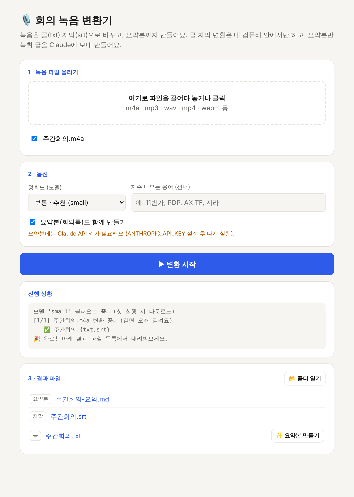

# 🎙️ 회의 녹음 → 글·자막 변환 (Whisper)

회의 녹음 파일을 **글(txt)**, **자막(srt)**, **요약본(md)** 으로 바꾸는 프로젝트입니다.
글·자막 변환은 OpenAI Whisper를 **내 컴퓨터에서** 돌리기 때문에 녹음이 외부 서버로 나가지 않습니다.
요약본은 변환된 **글**을 Claude API로 보내 만듭니다 (녹음 파일 자체는 보내지 않음).



## 1. 설치 (처음 한 번)

| 준비물 | macOS | Windows |
|---|---|---|
| Python 3.9+ | `brew install python` | [python.org](https://www.python.org/downloads/) (설치 시 "Add to PATH" 체크) |
| ffmpeg | `brew install ffmpeg` | `winget install ffmpeg` |

```bash
cd meeting-transcribe
python3 -m venv .venv
source .venv/bin/activate        # Windows: .venv\Scripts\activate
pip install -r requirements.txt  # openai-whisper, anthropic
```

요약본 기능을 쓰려면 [Claude API 키](https://console.anthropic.com/)를 환경변수로 설정합니다.

```bash
export ANTHROPIC_API_KEY=sk-ant-...      # Windows: setx ANTHROPIC_API_KEY sk-ant-...  (설정 후 창 다시 열기)
```

## 2. 사용법

### 🖱️ 버튼 화면 (추천)

- **Mac**: `실행-Mac.command` 더블클릭 (처음엔 우클릭 → 열기)
- **Windows**: `실행-Windows.bat` 더블클릭
- 또는 터미널에서 `python app.py`

브라우저에 화면이 열리면:

1. 녹음 파일을 끌어다 놓기
2. 정확도·용어 고르고 **요약본도 함께 만들기** 체크
3. **▶ 변환 시작** → 아래 목록에서 글·자막·요약본 내려받기

이미 만든 글(txt) 옆의 **✨ 요약본 만들기** 버튼으로 요약본만 따로 만들 수도 있습니다.
화면은 `127.0.0.1`(내 컴퓨터)에서만 열리며, 끄려면 터미널 창에서 `Ctrl+C`.

### 요약본만 명령어로

```bash
python summarize.py output/회의.txt     # → output/회의-요약.md
```

요약본 구성: 한눈에 보기 · 주요 논의 · 결정 사항 · 액션 아이템(담당/할 일/기한) · 미결 사항

### 가장 간단한 방법: 명령 한 줄

```bash
whisper 회의.m4a --model small --language Korean
```

같은 폴더에 `회의.txt`, `회의.srt` 등이 생깁니다.
(txt와 srt만 원하면 `--output_format txt` 처럼 하나씩 지정하거나, 아래 스크립트를 쓰세요.)

### 프로젝트 방식: 폴더에 넣고 한 번에 변환

1. 녹음 파일을 `input/` 폴더에 넣습니다 (m4a, mp3, wav, mp4, webm 등).
2. 실행합니다.
   ```bash
   python transcribe.py
   ```
3. `output/` 폴더에 `파일명.txt` 와 `파일명.srt` 가 생깁니다.

유용한 옵션:

```bash
python transcribe.py 회의.m4a                   # 파일 하나만
python transcribe.py --model medium             # 더 정확하게 (느림)
python transcribe.py --prompt "11번가, PDP, AX TF, 지라"   # 고유명사·용어 인식률 향상
python transcribe.py --formats txt,srt,vtt      # 웹 자막(vtt)도 함께
```

> `input/`, `output/` 내용은 `.gitignore`로 막아 두어 회의 녹음과 내용이 저장소에 올라가지 않습니다.

## 3. 모델 고르기

| 모델 | 속도 | 정확도 | 권장 상황 |
|---|---|---|---|
| `tiny` / `base` | 매우 빠름 | 낮음 | 테스트용 |
| **`small`** | 빠름 | 괜찮음 | **기본값, 일반 회의** |
| `medium` | 느림 | 높음 | 전문용어가 많을 때 |
| `turbo` | 빠름 | 높음 | GPU가 있을 때 추천 |
| `large` | 가장 느림 | 가장 높음 | 중요한 회의, GPU 필요 |

첫 실행 때 모델이 자동으로 내려받아집니다 (small 약 460MB).
CPU만으로는 small 모델 기준 녹음 1시간에 수십 분 정도 걸릴 수 있습니다.

## 4. Claude Code에서 쓰기

이 저장소에는 `meeting-transcribe` 스킬이 들어 있습니다. Claude Code에서
"input에 있는 회의 녹음 회의록으로 만들어줘"라고 하면 변환 → 요약본(`output/파일명-요약.md`)까지 진행합니다.

## 자주 묻는 질문

- **`ffmpeg not found`** → 1번의 ffmpeg 설치를 확인하세요.
- **`FP16 is not supported on CPU` 경고** → 무시해도 됩니다 (CPU에서는 FP32로 자동 전환).
- **요약본이 안 만들어져요** → 화면의 주황색 안내를 확인하세요. 대부분 `pip install anthropic` 또는 API 키 설정 문제입니다.
- **화자 구분(누가 말했는지)** → Whisper 자체 기능에는 없습니다. 회의록 단계에서 맥락으로 추정하거나, 필요하면 pyannote 같은 도구를 추가해야 합니다.
